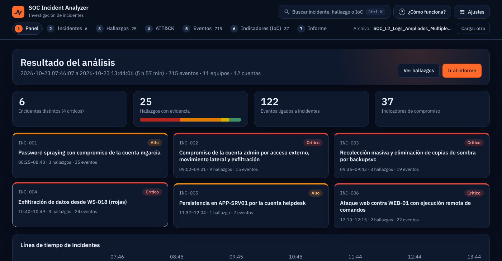
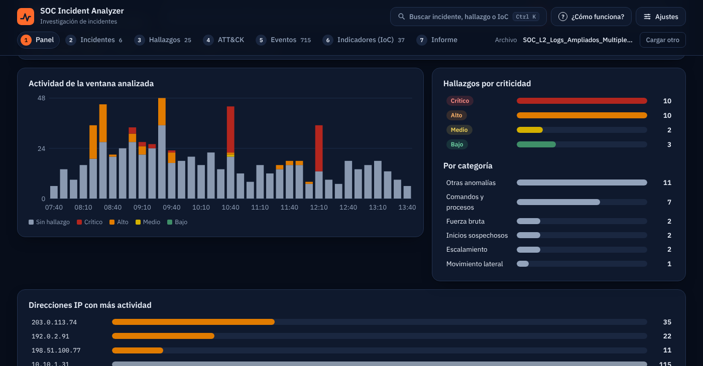
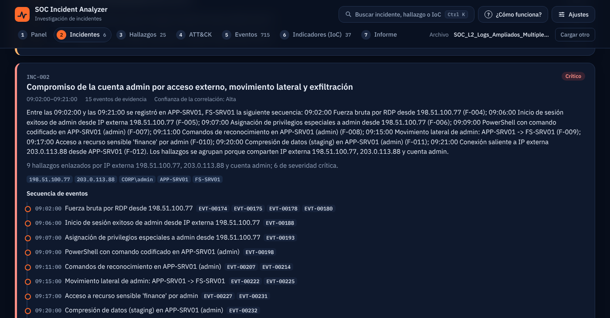
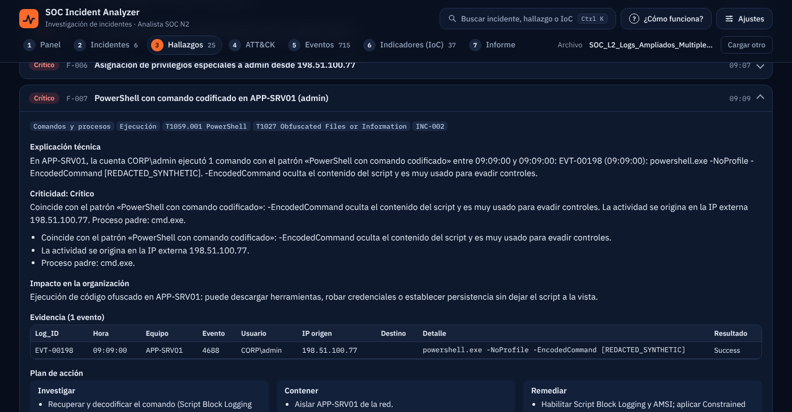
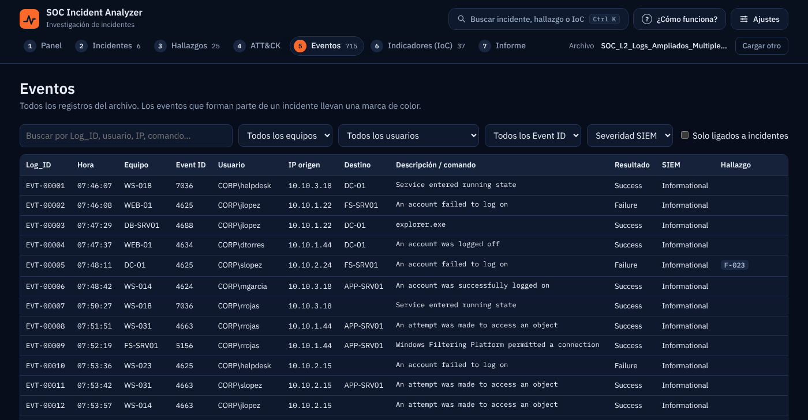
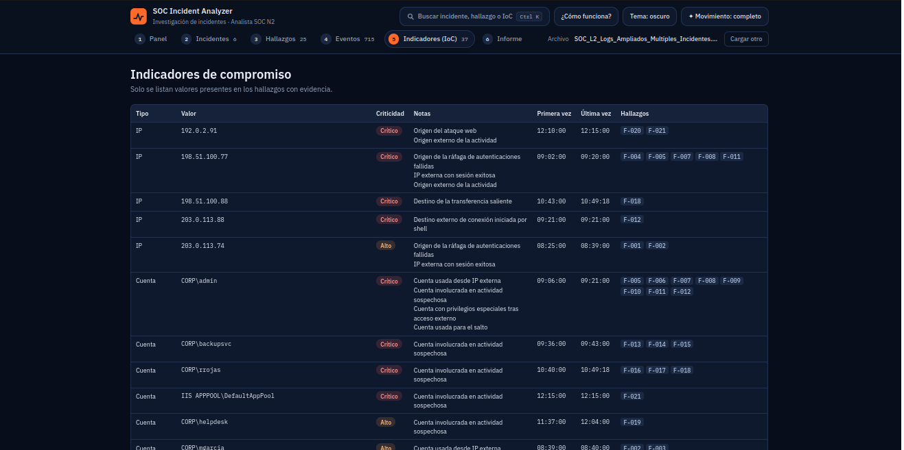
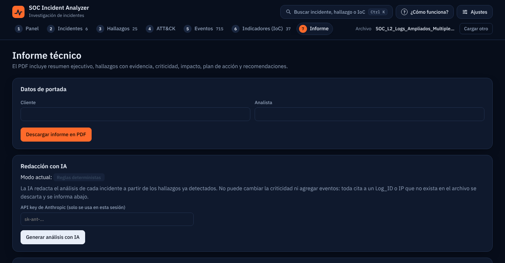

# SOC Incident Analyzer

 [](https://github.com/braianffernandez096-bripto/soc-incident-analyzer/actions/workflows/tests.yml)  

Aplicación web para el reto final del Bootcamp Analista SOC Nivel 2. Recibe el export de un SIEM (Excel, CSV/TSV o JSON/NDJSON), detecta indicadores de compromiso, correlaciona los eventos en incidentes, clasifica la criticidad (Crítico / Alto / Medio / Bajo) y genera el informe técnico en PDF.

## Cómo funciona

1. **Motor de reglas determinista** (`backend/detection.py`): fuerza bruta y password spraying, inicios de sesión externos, escalamiento de privilegios, comandos y procesos sospechosos, movimiento lateral, acceso masivo a archivos, exfiltración, persistencia, ataques web y problemas de calidad de datos. Cada hallazgo cita los `Log_ID` que lo sustentan y explica por qué tiene esa criticidad.

2. **Correlación**: los hallazgos se agrupan en incidentes cuando comparten IP externa o cuenta de actor. Compartir host o recurso no fusiona incidentes; queda como hipótesis de confianza baja.

3. **IA (Claude)** (`backend/ai.py`): redacta la narrativa, la explicación técnica, el impacto y el plan de acción de cada incidente a partir de los hallazgos ya detectados. No puede cambiar la criticidad. Un verificador descarta cualquier `Log_ID` o IP que no exista en el archivo. Sin API key, o si la IA falla, el informe se genera con plantillas deterministas.

4. **PDF** (`backend/report.py`): resumen ejecutivo, hallazgos, evidencia, criticidad y justificación, impacto, plan de acción (investigar, contener, remediar) y recomendaciones generales.

## Formatos de entrada

| Formato | Extensiones | Detalles |
|---|---|---|
| Excel | `.xlsx`, `.xlsm` | Usa la hoja con más filas; detecta la fila de cabecera aunque haya títulos encima. |
| CSV / TSV | `.csv`, `.tsv`, `.txt`, `.log` | Detecta el separador (`,` `;` tab `|`) y la codificación (UTF-8, UTF-16, Windows-1252). |
| JSON | `.json` | Arreglo de eventos, contenedores como `{"events": [...]}` y respuestas de Elasticsearch/OpenSearch (`hits.hits[]._source`). |
| NDJSON | `.jsonl`, `.ndjson` | Un evento por línea; también el formato de exportación de Splunk (`{"result": {...}}`). |

- **Columnas:** se reconocen por nombre aunque cambien mayúsculas, acentos o idioma (`Descripción`, `hostname`, `Equipo`…) y los campos anidados típicos de Elastic ECS / Winlogbeat (`@timestamp`, `host.name`, `winlog.event_id`, `source.ip`, `user.name`, `process.command_line`…). Solo son indispensables `Timestamp` y `Event_ID`; lo que falte queda vacío y se informa.
- **Marcas de tiempo:** si traen zona horaria (`Z`, `+02:00`) o son epoch (segundos, milisegundos…), se convierten a UTC y el informe lo declara. Si no la traen, se usan tal cual.
- **Log_ID:** si no existe, se generan identificadores `ROW-00001…` estables.
- Un `.txt` o `.log` que contenga JSON se detecta por su contenido.

## Resultado con el Excel de ejemplo

`sample_data/SOC_L2_Logs_Ampliados_Multiples_Incidentes.xlsx` (715 eventos, ~6 h; también en `.csv` y `.ndjson`, con el mismo resultado) produce **25 hallazgos** agrupados en **6 incidentes**:

| ID | Incidente | Criticidad |
|---|---|---|
| INC-001 | Password spraying con compromiso de la cuenta `mgarcia` | Alto |
| INC-002 | Compromiso de `admin` por acceso externo, movimiento lateral y exfiltración | Crítico |
| INC-003 | Recolección masiva y borrado de shadow copies por `backupsvc` | Crítico |
| INC-004 | Exfiltración de datos desde WS-018 (`rrojas`) | Crítico |
| INC-005 | Persistencia en APP-SRV01 por la cuenta `helpdesk` | Alto |
| INC-006 | Ataque web contra WEB-01 con ejecución remota de comandos | Crítico |

Las IP y los datos del ejemplo son sintéticos (rangos de documentación RFC 5737).

## Capturas

**Panel: resumen e incidentes detectados**



**Panel: actividad, hallazgos por criticidad e IP con más movimiento**



**Incidentes: secuencia de eventos con el `Log_ID` que respalda cada paso** (INC-002)



**Hallazgos: explicación técnica, criticidad, impacto y plan de acción**



**Eventos: los 715 registros originales, con marca de los ligados a incidentes**



**Indicadores de compromiso (IoC)**



**Informe: datos de portada, redacción con IA y descarga del PDF**



**Informe técnico generado**

[Ver el informe de ejemplo en PDF](examples/informe-ejemplo.pdf) (29 páginas: resumen ejecutivo, 6 incidentes, hallazgos con evidencia, plan de acción y recomendaciones). El nombre del cliente es ficticio.

## Instalación y ejecución (Ubuntu 24.04)

```bash
# 1. Dependencias del sistema
sudo apt update && sudo apt install -y python3 python3-venv python3-pip git

# 2. Clonar el repositorio
git clone https://github.com/braianffernandez096-bripto/soc-incident-analyzer.git
cd soc-incident-analyzer

# 3. Entorno virtual e instalación
python3 -m venv .venv
source .venv/bin/activate
pip install -r requirements.txt

# 4. (Opcional) clave de Anthropic para el análisis con IA
cp .env.example .env
nano .env                       # ANTHROPIC_API_KEY=...

# 5. Iniciar la aplicación
uvicorn backend.main:app --host 127.0.0.1 --port 8000
```

Abre http://127.0.0.1:8000, sube el export del SIEM (puedes usar cualquiera de los de `sample_data/`), revisa el análisis y descarga el informe en la pestaña **Informe**. Si no definiste la clave en `.env`, puedes pegarla ahí; solo se usa durante esa sesión.

En Windows, la activación del entorno es `.venv\Scripts\activate`.

### Con Docker

Si preferís no instalar Python, con Docker y Docker Compose alcanza:

```bash
git clone https://github.com/braianffernandez096-bripto/soc-incident-analyzer.git
cd soc-incident-analyzer
cp .env.example .env            # opcional: tus claves (Anthropic, VirusTotal, AbuseIPDB)
docker compose up --build
```

Abre http://127.0.0.1:8000. El puerto queda publicado solo en tu equipo (`127.0.0.1`) porque la app no tiene login. La imagen corre con un usuario sin privilegios y no incluye tu `.env`: la clave se pasa como variable de entorno.

## Reputación de IP y dominios (VirusTotal y AbuseIPDB)

Opcional. En la pestaña **IoC**, el botón **Consultar reputación** enriquece los indicadores externos con VirusTotal (cuántos motores los marcan como maliciosos) y AbuseIPDB (puntaje de confianza de abuso y reportes de los últimos 90 días). El resultado aparece en la tabla de IoC y en una sección del informe PDF.

- **Tú decides qué sale.** Antes de consultar, la app muestra la lista exacta de indicadores que se enviarán y los que se omiten, con el motivo. Solo viajan IP públicas y dominios; nunca IP internas, cuentas, equipos, comandos ni contenido de los logs.
- **Las IP de documentación (RFC 5737) no se consultan**, porque no tienen reputación real. El export de ejemplo usa solo esas, así que allí no hay nada que enviar; hay una casilla para incluirlas únicamente si quieres probar que tu clave funciona.
- **No cambia la criticidad.** La reputación es contexto para el analista; el motor de reglas sigue decidiendo.
- **Claves gratuitas:** crea una cuenta en [VirusTotal](https://www.virustotal.com) y otra en [AbuseIPDB](https://www.abuseipdb.com) y define `VT_API_KEY` y `ABUSEIPDB_API_KEY` en `.env`, o pégalas en la interfaz (solo se usan en esa consulta). Con una sola de las dos funciona igual.
- **Límites del plan gratuito:** VirusTotal permite 4 consultas por minuto y 500 por día, así que la app consulta una cada ~15 s (25 indicadores como máximo por consulta, ~6 min). AbuseIPDB permite 1.000 por día. Si una clave es rechazada o se agota la cuota, esa consulta se detiene con un aviso.

## Pruebas

```bash
python -m pytest                                           # 155 pruebas
python -m pytest --cov=backend --cov-report=term-missing   # con cobertura (93 %)
```

- `tests/unit/`: motor de detección contra el Excel de ejemplo, límites del parser y formatos de entrada (CSV, TSV, JSON, NDJSON, codificaciones y zonas horarias).
- `tests/integration/`: API con entradas hostiles (archivo falso, markup en celdas y portada, 413, 429, cabeceras) capa de IA y consultas de reputación con servidores simulados (las pruebas no usan red ni claves).
- `tests/e2e/`: arranca el servidor real y recorre carga, análisis y PDF.

## Seguridad

- Las claves (Anthropic, VirusTotal, AbuseIPDB) viven en `.env` (excluido de Git) o se pegan en la interfaz; nunca se guardan, se registran ni se devuelven al navegador.
- Todo dato del archivo se escapa antes de mostrarse y antes de entrar al PDF. La interfaz aplica una CSP estricta (`script-src 'self'`).
- Límites: 25 MB de subida (lectura acotada), 300 MB descomprimidos, 100.000 filas y límite de peticiones por IP.
- La app no tiene login: úsala en local. Si la expones en red, ponla detrás de un proxy con autenticación.

## Límites

- Si las marcas de tiempo no traen zona horaria, se usan tal cual; si la traen, se convierten a UTC.
- Los rangos 192.0.2.0/24, 198.51.100.0/24 y 203.0.113.0/24 (documentación) se tratan como externos.
- El mapeo MITRE ATT&CK es orientativo. La reputación de IP es opcional y orientativa; no hay geolocalización propia.
- Los archivos de sesión viven en memoria (máx. 10) y se pierden al reiniciar el servidor.

## Estructura

```
backend/      parser, reglas de detección, correlación, IA, informe PDF y API (FastAPI)
frontend/     interfaz web sin build (HTML, CSS y JS; fuentes IBM Plex locales)
sample_data/  export de ejemplo en Excel, CSV y NDJSON
tests/        unit, integration y e2e
```

## Licencia

MIT. Las fuentes IBM Plex conservan su licencia (`frontend/vendor/fonts/LICENSE-IBM-Plex.txt`).
