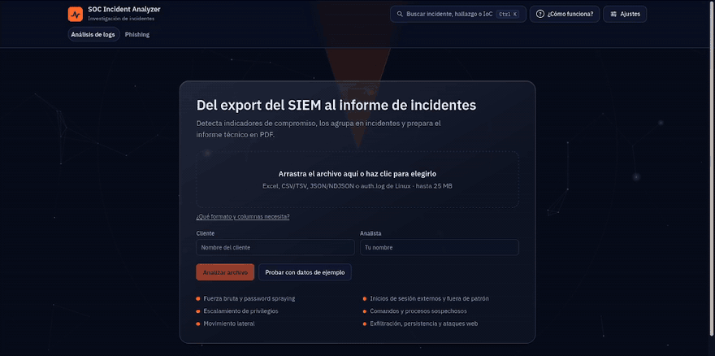
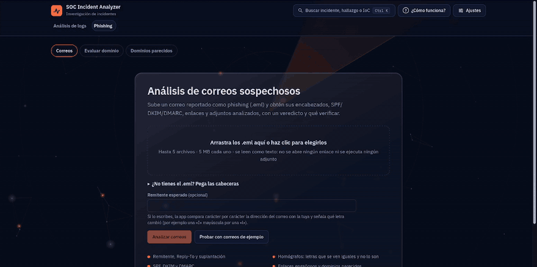
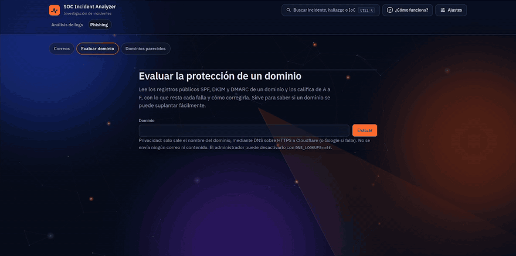
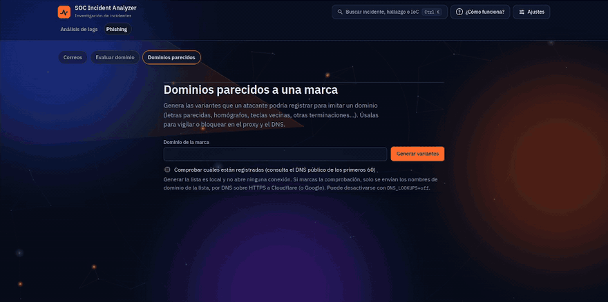
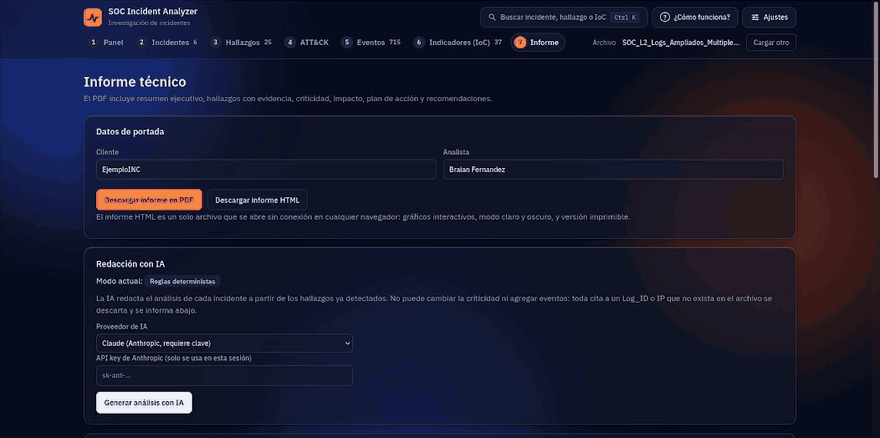

# SOC Incident Analyzer

 [](https://github.com/braianffernandez096-bripto/soc-incident-analyzer/actions/workflows/tests.yml) [](https://codecov.io/gh/braianffernandez096-bripto/soc-incident-analyzer) 

Aplicación web para análisis de logs. Recibe el export de un SIEM (Excel, CSV/TSV o JSON/NDJSON), detecta indicadores de compromiso, correlaciona los eventos en incidentes, clasifica la criticidad (Crítico / Alto / Medio / Bajo) y genera el informe técnico en PDF.

## Qué problema resuelve y para quién

Un SIEM entrega miles de eventos y el analista tiene que decidir cuáles importan, cómo se relacionan y qué hacer primero.
Esta herramienta toma el export de un SIEM (Excel, CSV o JSON) y lo convierte en incidentes ordenados por criticidad, cada uno con las evidencias que lo sustentan.
Cada hallazgo se mapea a MITRE ATT&CK y trae un plan de acción (investigar, contener, remediar) y un informe técnico en PDF.

Está pensada para analistas SOC y estudiantes que practican triage, y para quien quiera ver cómo se correlacionan los eventos sin montar un SIEM completo.
El análisis, los incidentes, MITRE ATT&CK y el informe en PDF funcionan sin Internet y sin costo, porque las reglas son deterministas y el informe usa plantillas. La redacción con IA es opcional: puedes usar tu propia clave de API de Anthropic, OpenAI o Gemini (servicios de pago por uso) o un modelo local con Ollama, sin costo y sin enviar datos a terceros. Solo mejora la redacción, nunca cambia la criticidad.

## Cómo se desarrolló

Proyecto personal, hecho para practicar el análisis de incidentes. Lo desarrollé con ayuda de un asistente de IA (Claude, de Anthropic): yo definí qué debía detectar y cómo, revisé cada cambio, probé la aplicación con logs propios y decidí qué entra en el repositorio; el asistente escribió gran parte del código y de las pruebas. Por eso las decisiones de seguridad (la IA no puede cambiar la criticidad, los datos se tratan como no confiables) están cubiertas por pruebas automáticas y el historial de cambios está en el [CHANGELOG](CHANGELOG.md).

## Cómo funciona

Un motor de reglas determinista detecta fuerza bruta, movimiento lateral, escalamiento de privilegios, persistencia, exfiltración, ataques web y más (Windows, SSH, web, DNS y nube). Cada hallazgo cita los `Log_ID` que lo sustentan, se agrupa en incidentes y se mapea a MITRE ATT&CK, con consultas para tu SIEM (Splunk, Sentinel, Sigma) y un informe en PDF o HTML. La IA y la reputación son opcionales y nunca cambian la criticidad. Detalle de cada parte: [docs/DESARROLLO.md](docs/DESARROLLO.md#cómo-funciona-detalle).

Acepta Excel, CSV/TSV, JSON/NDJSON y `auth.log` de Linux; solo exige `Timestamp` y `Event_ID`. Formatos y ejemplos: [docs/FORMATOS.md](docs/FORMATOS.md).

## Resultado con el Excel de ejemplo

`sample_data/SOC_L2_Logs_Ampliados_Multiples_Incidentes.xlsx` (715 eventos, ~6 h; también en `.csv` y `.ndjson`, con el mismo resultado) produce **25 hallazgos** agrupados en **6 incidentes**:

| ID | Incidente | Criticidad |
|---|---|---|
| INC-001 | Password spraying con compromiso de la cuenta `mgarcia` | Alto |
| INC-002 | Compromiso de la cuenta `admin` por acceso externo, movimiento lateral y exfiltración | Crítico |
| INC-003 | Recolección masiva y eliminación de copias de sombra por `backupsvc` | Crítico |
| INC-004 | Exfiltración de datos desde WS-018 (`rrojas`) | Crítico |
| INC-005 | Persistencia en APP-SRV01 por la cuenta `helpdesk` | Alto |
| INC-006 | Ataque web contra WEB-01 con ejecución remota de comandos | Crítico |

Las IP y los datos del ejemplo son sintéticos (rangos de documentación RFC 5737). Hay otros ejemplos con distintas fuentes (SSH, web, DNS, nube, correo) en [docs/FORMATOS.md](docs/FORMATOS.md#datos-de-ejemplo).

## Demostración

**Análisis de logs: del export del SIEM al panel, los incidentes, los hallazgos y el informe**



**Phishing: análisis de correos de ejemplo, detalle con homógrafos y descarga del informe HTML**



**Evaluar dominio: nota de A a F con lo que resta cada comprobación (SPF, DKIM y DMARC)**



**Dominios parecidos: variantes de typosquatting y comprobación de cuáles están registradas**



<details>
<summary>Ver el informe HTML del análisis de logs</summary>



</details>

Informe técnico de ejemplo: [ver el PDF](examples/informe-ejemplo.pdf) (29 páginas; el nombre del cliente es ficticio).

## Instalación y ejecución (Ubuntu 24.04)

**Requiere Python 3.12 o superior** (Ubuntu 24.04 ya lo trae). En Ubuntu 22.04 la versión del sistema es 3.10 y la instalación falla; mira *Si algo falla*.

```bash
# 1. Dependencias del sistema
sudo apt update && sudo apt install -y python3 python3-venv python3-pip git make

# 2. Clonar el repositorio
git clone https://github.com/braianffernandez096-bripto/soc-incident-analyzer.git
cd soc-incident-analyzer

# 3. Entorno virtual e instalación
python3 -m venv .venv
source .venv/bin/activate
pip install --require-hashes -r requirements.lock      # versiones exactas, verificadas por hash

# 4. (Opcional) claves: Anthropic para la redacción con IA (de pago); VirusTotal y AbuseIPDB para reputación. Para IA local sin clave, instala Ollama y un modelo (ver [IA local](docs/IA-LOCAL.md))
cp .env.example .env
nano .env                       # ANTHROPIC_API_KEY=...  VT_API_KEY=...  ABUSEIPDB_API_KEY=...

# 5. Iniciar la aplicación
uvicorn backend.main:app --host 127.0.0.1 --port 8000
```

Abre http://127.0.0.1:8000, sube el export del SIEM (puedes usar cualquiera de los de `sample_data/`, o pulsar **Probar con datos de ejemplo** para verlo sin buscar ningún archivo), revisa el análisis y descarga el informe en la pestaña **Informe**. Si no definiste la clave en `.env`, puedes pegarla ahí; solo se usa durante esa sesión.

En Windows, la activación del entorno es `.venv\Scripts\activate`.

### Con Docker

Si prefieres no instalar Python, con Docker y Docker Compose alcanza:

```bash
git clone https://github.com/braianffernandez096-bripto/soc-incident-analyzer.git
cd soc-incident-analyzer
cp .env.example .env            # opcional: tus claves (Anthropic, VirusTotal, AbuseIPDB)
docker compose up --build
```

Abre http://127.0.0.1:8000. El puerto queda publicado solo en tu equipo (`127.0.0.1`) porque la app no tiene login. La imagen corre con un usuario sin privilegios y no incluye tu `.env`: las claves se pasan como variables de entorno.

## Más funciones

- **Phishing:** análisis estático de `.eml` (SPF/DKIM/DMARC, enlaces, homógrafos, adjuntos) con veredicto y puntaje; evaluación de dominio y dominios parecidos. Nunca abre enlaces ni ejecuta adjuntos. [Detalle](docs/DESARROLLO.md#análisis-de-correos-phishing-detalle).
- **Informe HTML:** un solo archivo que se abre sin conexión, con gráficos, modo claro/oscuro y versión imprimible, para logs y para phishing. [Detalle](docs/INFORME-HTML.md).
- **Triaje asistido por IA:** recomienda Escalar, Probable falso positivo o Falta información; la severidad la fija siempre el motor. [Detalle](docs/TRIAGE.md).
- **IA opcional:** Claude, OpenAI o Gemini con tu clave ([docs/PROVEEDORES-IA.md](docs/PROVEEDORES-IA.md)), o un modelo local con Ollama sin costo y sin enviar datos ([docs/IA-LOCAL.md](docs/IA-LOCAL.md)). Un modelo local pequeño sirve para practicar; para el informe formal se aconseja uno de mayor calidad.
- **Reputación de IP y dominios:** VirusTotal y AbuseIPDB, solo con tu confirmación y sin enviar datos internos. [Detalle](docs/REPUTACION.md).

## Pruebas y validación

```bash
pip install --require-hashes -r requirements-dev.lock
python -m pytest                                           # ~1.200 pruebas
python -m pytest --cov=backend --cov-report=term-missing   # con cobertura (95 %)
```

Hay pruebas unitarias, de integración, de extremo a extremo con navegador real y casos de actividad normal que no deben alertar; atajos con `make` (`make help`). Las reglas se midieron con datos que no escribí yo: las 11 IPs de fuerza bruta de un SSH real (Loghub) sin falsos positivos, la técnica correcta en 41 de 107 ataques de Windows (antes de calibrar: 13) y 86,4 % de 12.864 correos de phishing reales con criticidad Medio o más. Método y límites: [docs/VALIDACION.md](docs/VALIDACION.md); pruebas: [docs/DESARROLLO.md](docs/DESARROLLO.md#pruebas).

## Privacidad y seguridad

La app corre en tu equipo y no envía telemetría; solo salen datos si activas la IA de un proveedor, la consulta DNS o la reputación ([docs/PRIVACIDAD.md](docs/PRIVACIDAD.md)). Los datos del archivo se tratan como no confiables (escape, CSP estricta, tipo por contenido), las claves nunca se guardan y la IA no puede cambiar la criticidad. Contenedor sin privilegios y CI con `bandit`, `pip-audit` y Trivy: [detalle](docs/DESARROLLO.md#seguridad-detalle) y [SECURITY.md](SECURITY.md). Para colaborar: [CONTRIBUTING.md](CONTRIBUTING.md).

## Si algo falla, límites y estructura

- **Errores comunes** (formato, claves, Python 3.12, puerto ocupado): [docs/DESARROLLO.md](docs/DESARROLLO.md#si-algo-falla).
- **Límites** (zona horaria, rangos de documentación, MITRE orientativo, sesiones en memoria): [docs/DESARROLLO.md](docs/DESARROLLO.md#límites).
- **Estructura:** `backend/` (API FastAPI y motor), `frontend/` (interfaz sin build), `tests/`, `scripts/`, `sample_data/` y `docs/`. Árbol completo: [docs/DESARROLLO.md](docs/DESARROLLO.md#estructura).

## Licencia

MIT. Las fuentes IBM Plex conservan su licencia (`frontend/vendor/fonts/LICENSE-IBM-Plex.txt`). anime.js 3.2.2 (MIT, © Julian Garnier) va incluido en el informe HTML y en el Panel: `backend/assets/ANIME-LICENSE.md` y `frontend/vendor/ANIME-LICENSE.md`.
