# SOC Incident Analyzer

 [](https://github.com/braianffernandez096-bripto/soc-incident-analyzer/actions/workflows/tests.yml) [](https://codecov.io/gh/braianffernandez096-bripto/soc-incident-analyzer) 

Aplicación web para análisis de logs. Recibe el export de un SIEM (Excel, CSV/TSV o JSON/NDJSON), detecta indicadores de compromiso, correlaciona los eventos en incidentes, clasifica la criticidad (Crítico / Alto / Medio / Bajo) y genera el informe técnico en PDF.

## Qué problema resuelve y para quién

Un SIEM entrega miles de eventos y el analista tiene que decidir cuáles importan, cómo se relacionan y qué hacer primero.
Esta herramienta toma el export de un SIEM (Excel, CSV o JSON) y lo convierte en incidentes ordenados por criticidad, cada uno con las evidencias que lo sustentan.
Cada hallazgo se mapea a MITRE ATT&CK y trae un plan de acción (investigar, contener, remediar) y un informe técnico en PDF.

Está pensada para analistas SOC y estudiantes que practican triage, y para quien quiera ver cómo se correlacionan los eventos sin montar un SIEM completo.
El análisis, los incidentes, MITRE ATT&CK y el informe en PDF funcionan sin Internet y sin costo, porque las reglas son deterministas y el informe usa plantillas. La redacción con IA es opcional: puedes usar tu propia clave de API de Anthropic (servicio de pago por uso) o un modelo local con Ollama, sin costo y sin enviar datos a terceros. Solo mejora la redacción, nunca cambia la criticidad.

## Cómo se desarrolló

Proyecto personal de Braian Fernandez, hecho para practicar el análisis de incidentes. Lo desarrollé con ayuda de un asistente de IA (Claude, de Anthropic): yo definí qué debía detectar y cómo, revisé cada cambio, probé la aplicación con logs propios y decidí qué entra en el repositorio; el asistente escribió gran parte del código y de las pruebas. Por eso las decisiones de seguridad (la IA no puede cambiar la criticidad, los datos se tratan como no confiables) están cubiertas por pruebas automáticas y el historial de cambios está en el [CHANGELOG](CHANGELOG.md).

## Cómo funciona

1. **Motor de reglas determinista** (`backend/detection.py`, `detection_generic.py`): fuerza bruta y password spraying, movimiento lateral, escalamiento de privilegios, persistencia, LSASS, DCSync, Kerberoasting, exfiltración, evasión de defensas, ataques web y más; para Windows (por Event ID) y para otras fuentes (SSH, web, DNS, cloud).

2. Cada hallazgo cita los `Log_ID` que lo sustentan y explica por qué tiene esa criticidad.

3. **Correlación**: los hallazgos se agrupan en incidentes cuando comparten IP externa o cuenta de actor.

4. **IA (Claude u Ollama local)** (`backend/ai.py`, `backend/ai_local.py`, opcional): solo redacta; no puede cambiar la criticidad y un verificador descarta lo inventado. Se elige el proveedor en la pestaña Informe. Sin clave ni Ollama, el informe usa plantillas.

5. **PDF** (`backend/report.py`): resumen ejecutivo, hallazgos, evidencia, impacto, plan de acción y recomendaciones.

6. **Reputación (opcional)** (`backend/intel.py`): VirusTotal y AbuseIPDB, solo con tu confirmación. Ver [más abajo](#reputación-de-ip-y-dominios-virustotal-y-abuseipdb).

7. **MITRE ATT&CK** (`backend/attack.py`): técnicas con nombre oficial, matriz por táctica y capa para ATT&CK Navigator. Sin Internet.

8. **Consultas para tu SIEM** (`backend/siemqueries.py`): Splunk (SPL), Sentinel (KQL) y reglas Sigma por cada hallazgo de Windows.

9. **Phishing** (`backend/phishing.py`): análisis estático de `.eml` (remitente, SPF/DKIM/DMARC, enlaces, homógrafos, adjuntos, ClickFix) con veredicto y puntaje.

10. **Verificar el remitente en DNS** (opcional): comprueba SPF, clave DKIM y política DMARC con el DNS de hoy y lo compara con las cabeceras.

Detalle de cada punto en [docs/DESARROLLO.md](docs/DESARROLLO.md#cómo-funciona-detalle).

## Formatos de entrada

| Formato | Extensiones | Detalles |
|---|---|---|
| Excel | `.xlsx`, `.xlsm` | Usa la hoja con más filas; detecta la fila de cabecera aunque haya títulos encima. |
| CSV / TSV | `.csv`, `.tsv`, `.txt`, `.log` | Detecta el separador (`,` `;` tab `\|`) y la codificación (UTF-8, UTF-16, Windows-1252). |
| JSON | `.json` | Arreglo de eventos, contenedores como `{"events": [...]}` (o cualquier otro nombre: se elige la lista que tiene fecha) y respuestas de Elasticsearch/OpenSearch (`hits.hits[]._source`). |
| NDJSON | `.jsonl`, `.ndjson` | Un evento por línea; también el formato de exportación de Splunk (`{"result": {...}}`). |
| auth.log / secure | `.log`, `.txt` | Syslog de Linux en texto (fecha clásica o ISO). Se leen los eventos de `sshd` (contraseña o clave aceptada/fallida) y de `sudo`; el resto de líneas se ignora y se avisa cuántas. Ejemplo: `sample_data/auth_log_ejemplo.txt`. Si el archivo no tiene extensión, agrégale `.log`. |

- **Columnas:** se reconocen por nombre aunque cambien mayúsculas, acentos o idioma (`Descripción`, `hostname`, `Equipo`…) y los campos anidados típicos de Elastic ECS / Winlogbeat (`@timestamp`, `host.name`, `winlog.event_id`, `source.ip`, `user.name`, `process.command_line`…). Solo son indispensables `Timestamp` y `Event_ID`; lo que falte queda vacío y se informa. Si el archivo no trae `Event_ID` pero sí `action` (o `event_type`), se usa como código de evento, y `category` pasa a ser la fuente del log.

- **Marcas de tiempo:** si traen zona horaria (`Z`, `+02:00`) o son epoch (segundos, milisegundos…), se convierten a UTC y el informe lo declara. Si no la traen, se usan tal cual.

- **Log_ID:** si no existe, se generan identificadores `ROW-00001…` estables.

- Un `.txt` o `.log` que contenga JSON se detecta por su contenido. Si un JSON se guardó línea por línea en una hoja de cálculo (`.csv` o `.xlsx`), se reconstruye; si le faltan líneas sueltas se lee lo que haya y se avisa.

## Resultado con el Excel de ejemplo

`sample_data/SOC_L2_Logs_Ampliados_Multiples_Incidentes.xlsx` (715 eventos, ~6 h; también en `.csv` y `.ndjson`, con el mismo resultado) produce **25 hallazgos** agrupados en **6 incidentes**:

| ID | Incidente | Criticidad |
|---|---|---|
| INC-001 | Password spraying con compromiso de la cuenta `mgarcia` | Alto |
| INC-002 | Compromiso de la cuenta `admin` por acceso externo, movimiento lateral y exfiltración | Crítico |
| INC-003 | Recolección masiva y eliminación de copias de sombra por `backupsvc` | Crítico |
| INC-004 | Exfiltración de datos desde WS-018 (`rrojas`) | Crítico |
| INC-005 | Persistencia en APP-SRV01 por la cuenta `helpdesk` | Alto |
| INC-006 | Ataque web contra WEB-01 con ejecución remota de comandos | Crítico |

Las IP y los datos del ejemplo son sintéticos (rangos de documentación RFC 5737).

`sample_data/logs_multifuente.json` (100 eventos de SSH, web, base de datos, DNS, correo, endpoint y nube) es un segundo ejemplo, y `sample_data/SIEM_Logs_500_Eventos.{csv,xlsx,json}` (500 eventos de un día con Windows, Linux, web, proxy, DNS, correo, EDR y nube) un tercero con 7 incidentes y señuelos que no deben alertar, sin Event IDs de Windows: produce **15 hallazgos** agrupados en **9 incidentes** (fuerza bruta SSH con compromiso de `admin`, ataque web con exfiltración, phishing con movimiento lateral, ransomware, escalamiento SUID, túnel DNS, abuso de identidad cloud, password spraying y minería).

## Demostración

**Análisis de logs: del export del SIEM al panel, los incidentes, los hallazgos y el informe**


**Phishing: análisis de correos de ejemplo, detalle con homógrafos y descarga del informe**


**Evaluar dominio: nota de A a F con lo que resta cada comprobación (SPF, DKIM y DMARC)**


**Dominios parecidos: variantes de typosquatting y comprobación de cuáles están registradas**


<details>
<summary>Ver los informes PDF generados (logs y phishing)</summary>


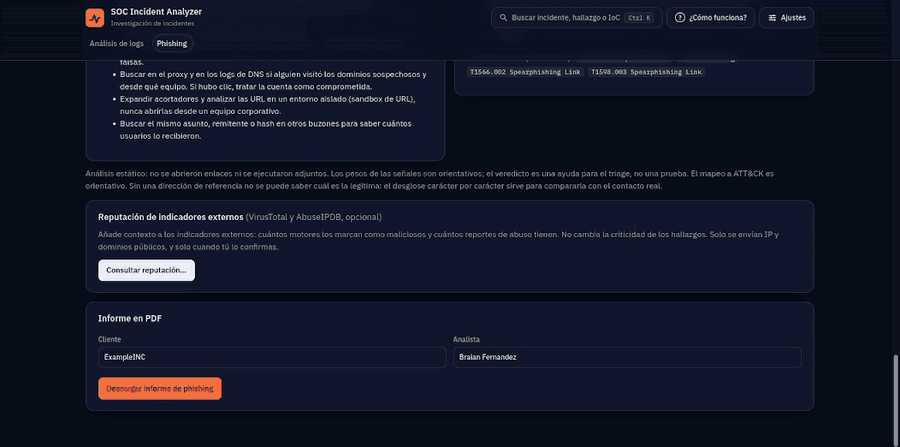

</details>

## Capturas

**Inicio: carga del archivo o prueba con datos de ejemplo** (arriba, las pestañas «Análisis de logs» y «Phishing»)

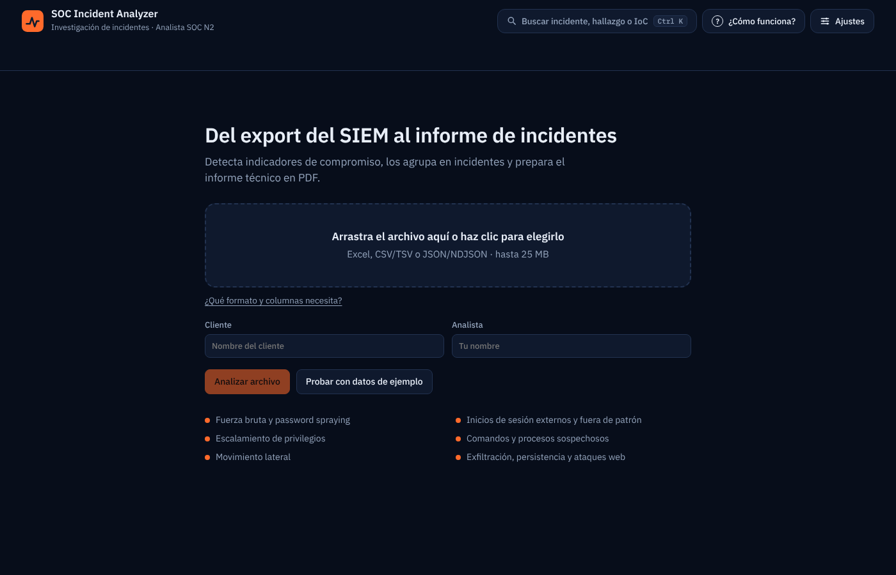

**Panel: resumen e incidentes detectados**


**Panel: actividad, hallazgos por criticidad e IP con más movimiento**


**Incidentes: secuencia de eventos con el `Log_ID` que respalda cada paso** (INC-002)


**Hallazgos: explicación técnica, criticidad, impacto y plan de acción**


**ATT&CK: técnicas sugeridas por los hallazgos, agrupadas por táctica, con descarga de la capa para Navigator**

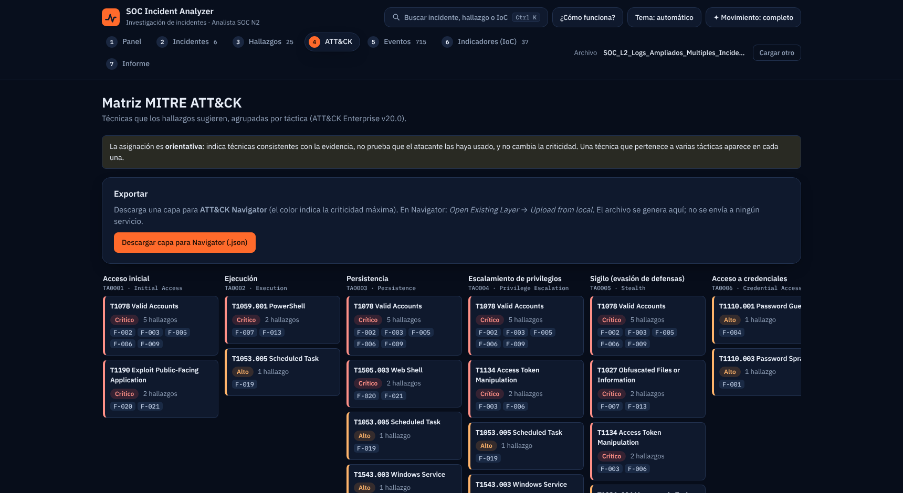

**Eventos: los 715 registros originales, con marca de los ligados a incidentes**


**Indicadores de compromiso (IoC)**


**Informe: datos de portada, redacción con IA y descarga del PDF**


**Verificación del archivo: un PNG renombrado a `.csv` se rechaza por su contenido, no por su extensión**

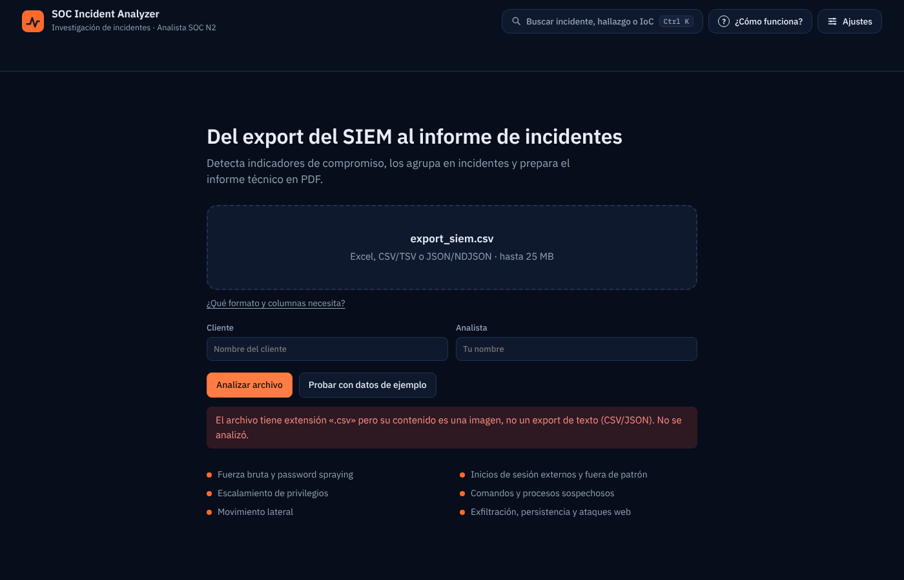

**Informe técnico generado**

[Ver el informe de ejemplo en PDF](examples/informe-ejemplo.pdf) (29 páginas: resumen ejecutivo, 6 incidentes, hallazgos con evidencia, plan de acción y recomendaciones). El nombre del cliente es ficticio.

### Capturas del análisis de correos (phishing)

**Phishing: carga de uno o varios `.eml` o de cabeceras pegadas, con el campo opcional «Remitente esperado»**

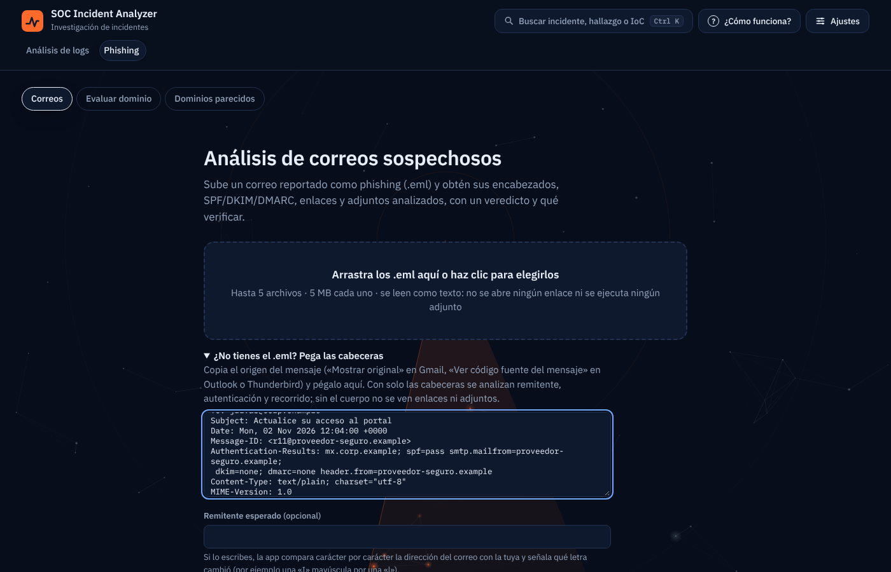

**Resultados: los correos de ejemplo ordenados por criticidad, con veredicto y puntaje**

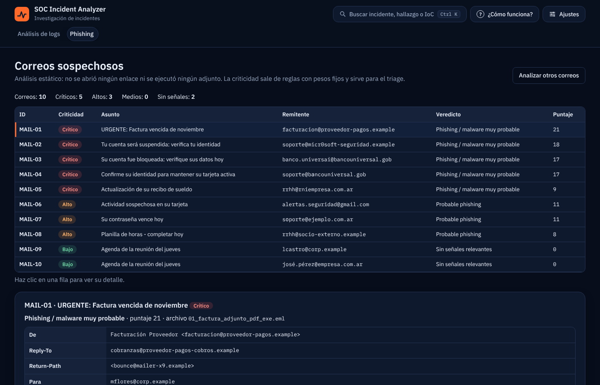

**Recorrido del correo: saltos `Received` del origen al destino, con hora UTC, retraso y avisos**

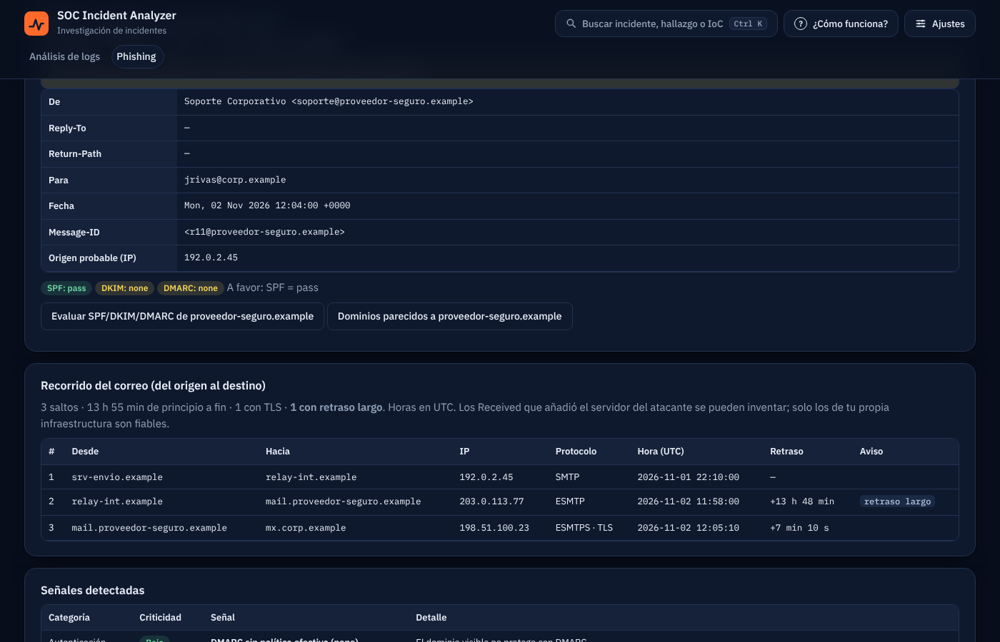

**Puntaje con factores visibles: qué sumó cada señal, los topes por categoría y los umbrales**

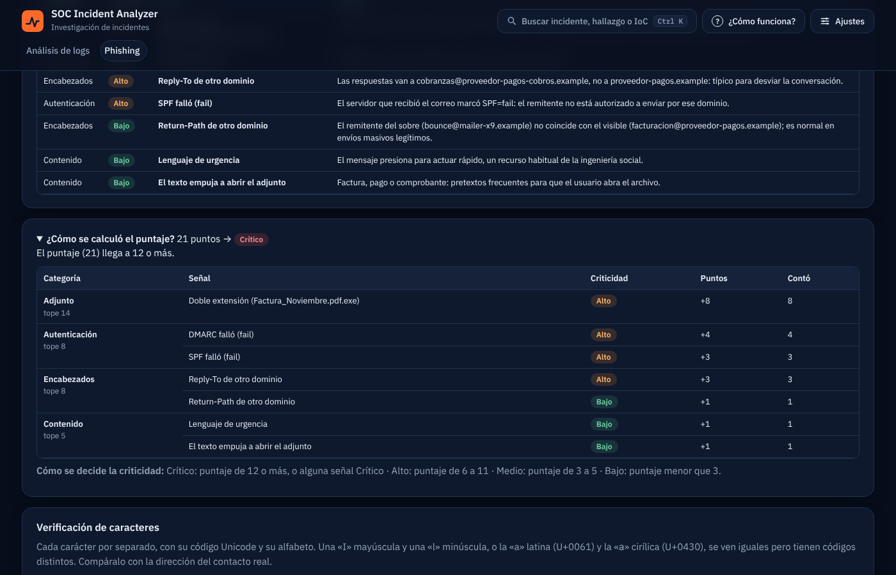

**Dominios parecidos: variantes de typosquatting con descarga de la lista**

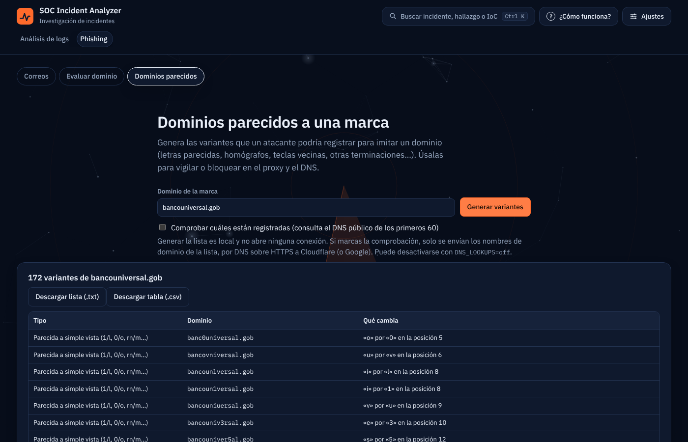

**Homógrafos: desglose carácter por carácter de un remitente con una «о» cirílica (U+043E) que parece latina**

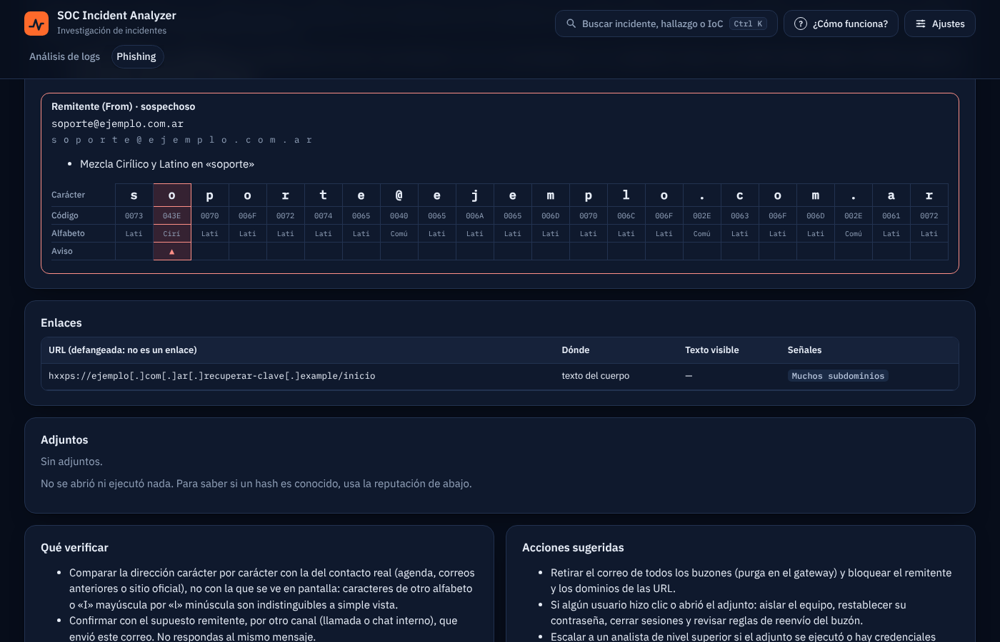

**Remitente esperado: se escribe la dirección legítima y la app señala qué letra cambió**

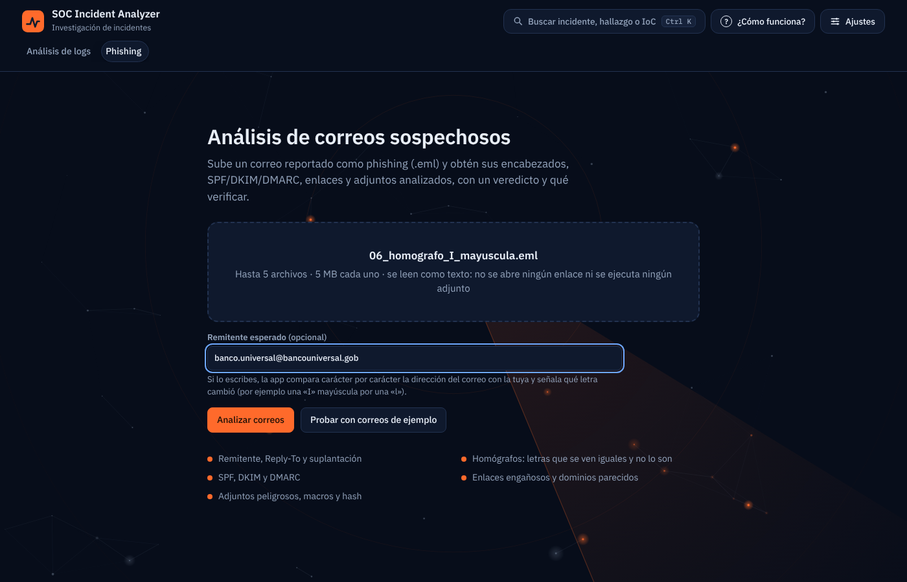

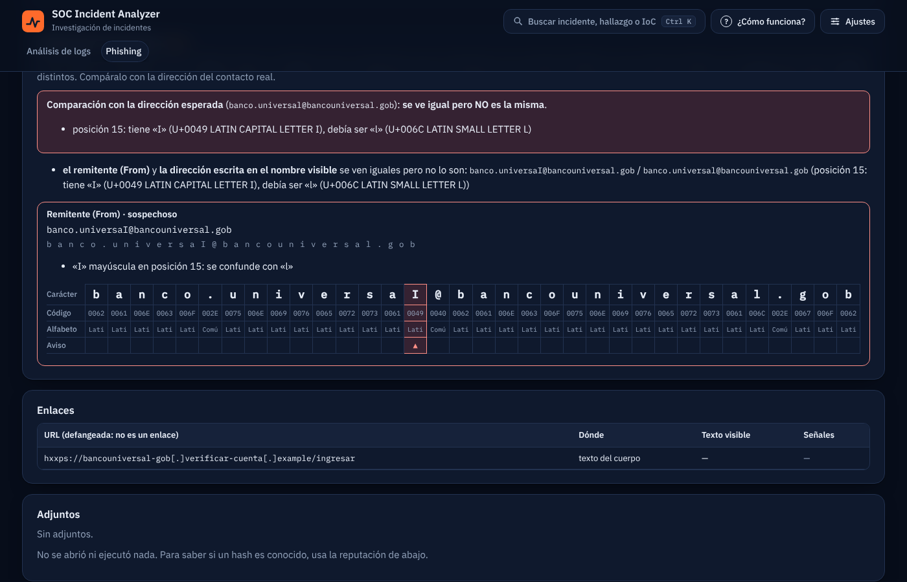

**Informe en PDF del análisis de correos** (los caracteres fuera del alfabeto latino se muestran como `[U+XXXX]`)

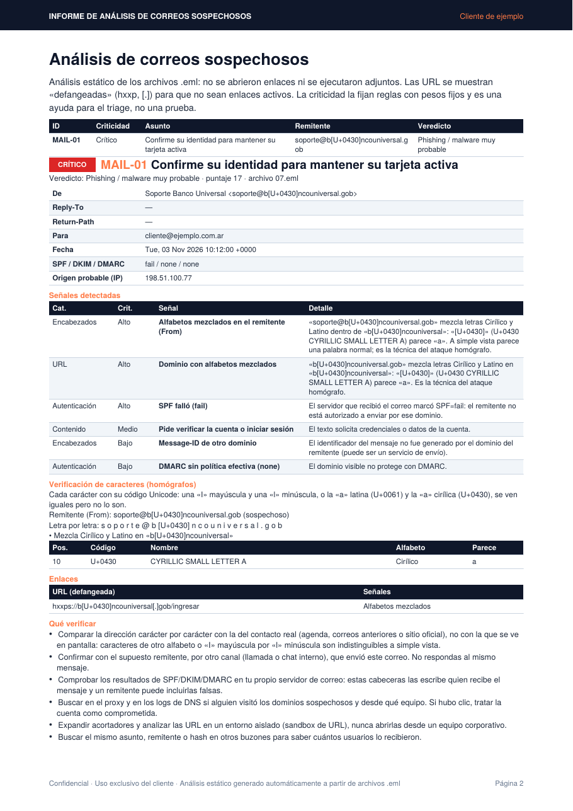

**Ayuda: «¿Cómo funciona?» tiene una sección para el análisis de logs y otra para phishing**

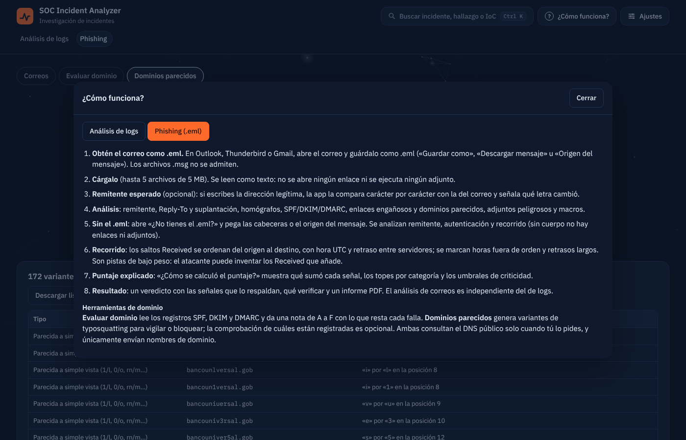

### Captcha local opcional (`CAPTCHA=on`)

**Imágenes: marcar las 3 que muestran la misma figura, aunque estén giradas o de otro color**

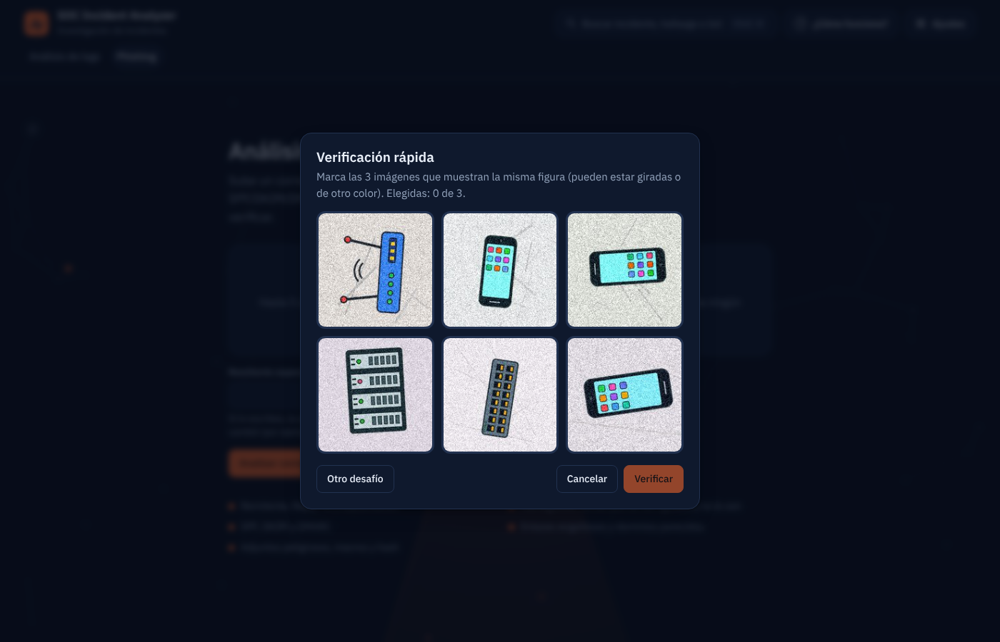

**Rompecabezas deslizante: arrastrar la pieza hasta el hueco correcto**

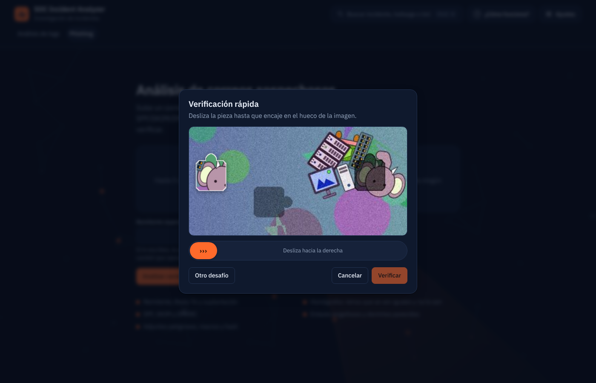

## Instalación y ejecución (Ubuntu 24.04)

**Requiere Python 3.12 o superior** (Ubuntu 24.04 ya lo trae). En Ubuntu 22.04 la versión del sistema es 3.10 y la instalación falla; mira *Si algo falla*.

```bash
# 1. Dependencias del sistema
sudo apt update && sudo apt install -y python3 python3-venv python3-pip git make

# 2. Clonar el repositorio
git clone https://github.com/braianffernandez096-bripto/soc-incident-analyzer.git
cd soc-incident-analyzer

# 3. Entorno virtual e instalación
python3 -m venv .venv
source .venv/bin/activate
pip install --require-hashes -r requirements.lock      # versiones exactas, verificadas por hash

# 4. (Opcional) claves: Anthropic para la redacción con IA (de pago); VirusTotal y AbuseIPDB para reputación. Para IA local sin clave, instala Ollama y un modelo (ver más abajo)
cp .env.example .env
nano .env                       # ANTHROPIC_API_KEY=...  VT_API_KEY=...  ABUSEIPDB_API_KEY=...

# 5. Iniciar la aplicación
uvicorn backend.main:app --host 127.0.0.1 --port 8000
```

Abre http://127.0.0.1:8000, sube el export del SIEM (puedes usar cualquiera de los de `sample_data/`, o pulsar **Probar con datos de ejemplo** para verlo sin buscar ningún archivo), revisa el análisis y descarga el informe en la pestaña **Informe**. Si no definiste la clave en `.env`, puedes pegarla ahí; solo se usa durante esa sesión.

En Windows, la activación del entorno es `.venv\Scripts\activate`.

### Con Docker

Si prefieres no instalar Python, con Docker y Docker Compose alcanza:

```bash
git clone https://github.com/braianffernandez096-bripto/soc-incident-analyzer.git
cd soc-incident-analyzer
cp .env.example .env            # opcional: tus claves (Anthropic, VirusTotal, AbuseIPDB)
docker compose up --build
```

Abre http://127.0.0.1:8000. El puerto queda publicado solo en tu equipo (`127.0.0.1`) porque la app no tiene login. La imagen corre con un usuario sin privilegios y no incluye tu `.env`: las claves se pasan como variables de entorno.

## Análisis de correos (phishing)

En la pestaña **Phishing** (disponible desde el inicio, sin cargar logs) sube uno o varios `.eml`, o pulsa **Probar con correos de ejemplo** (`sample_data/correos/`: 8 maliciosos, entre ellos 4 con homógrafos, 1 con un recorrido anómalo y 2 legítimos que no deben alertar). Para obtener un `.eml`: en Outlook, Thunderbird o Gmail guarda el correo como `.eml` o usa «Descargar mensaje». Los `.msg` no se admiten. Si no puedes exportarlo, **pega las cabeceras** (el «origen del mensaje») en el cuadro de la pantalla de carga.

Es análisis estático y determinista: no se abre ningún enlace ni se ejecuta ningún adjunto, y las URL se muestran «defangeadas». Incluye ataques homógrafos con desglose carácter por carácter, remitente esperado, recorrido `Received`, puntaje con factores visibles, evaluación de dominio (SPF/DKIM/DMARC) y dominios parecidos. Todo el detalle, con sus límites, está en [docs/DESARROLLO.md](docs/DESARROLLO.md#análisis-de-correos-phishing-detalle).

## IA local con Ollama (opcional)

Alternativa a Claude para quien no quiere pagar ni enviar datos a un tercero. En la pestaña **Informe**, elige **IA local (Ollama)** y uno de los modelos que tengas instalados.

```bash
# Instala Ollama (https://ollama.com) y un modelo; el nombre es de ejemplo, usa el que prefieras y tu equipo aguante
ollama pull llama3.1:8b
```

- **La dirección la define el servidor,** no el navegador: `OLLAMA_HOST` (por defecto `http://127.0.0.1:11434`). Con Docker, define en `.env` `OLLAMA_HOST=http://host.docker.internal:11434` (el contenedor alcanza el Ollama de tu equipo) y haz que Ollama escuche en todas las interfaces locales (`OLLAMA_HOST=0.0.0.0` en el servicio de Ollama), porque por defecto solo escucha en `127.0.0.1`.

- **Contexto:** Ollama recorta en silencio lo que supera su ventana (2.048-4.096 tokens por defecto), así que la app pide 16.384 (`OLLAMA_NUM_CTX` lo cambia). Si el equipo se queda sin memoria, usa un modelo más chico.

- **Mismas garantías que con Claude:** la criticidad la decide el motor, el verificador descarta los `Log_ID` y las IP inventados y, si el modelo falla, el informe se genera por reglas.

- **Calidad y tiempo:** un modelo local pequeño redacta peor que uno grande y, sin GPU, tarda minutos por consulta (medido con un modelo de 8B en una VM de 2 procesadores: unos 5 minutos por consulta con 100 eventos y bastante más con incidentes grandes). La app consulta de a una vez y espera hasta 60 minutos por consulta; `OLLAMA_TIMEOUT` (en segundos) lo cambia. Si una consulta se agota, ese incidente se redacta por reglas. Con cualquier modelo, la criticidad y la prioridad del plan de acción las fija el motor; un modelo chico solo puede empeorar el texto, no el orden de urgencia.

- **Sin probar con modelos reales en CI:** las pruebas usan un servidor Ollama simulado; el funcionamiento con cada modelo depende de tu equipo.

## Reputación de IP y dominios (VirusTotal y AbuseIPDB)

Opcional. En la pestaña **Indicadores (IoC)**, el botón **Consultar reputación** enriquece los indicadores externos con VirusTotal (cuántos motores los marcan como maliciosos) y AbuseIPDB (puntaje de confianza de abuso y reportes de los últimos 90 días). El resultado aparece en la tabla de IoC y en una sección del informe PDF.

- **Tú decides qué sale.** Antes de consultar, la app muestra la lista exacta de indicadores que se enviarán y los que se omiten, con el motivo. Solo viajan IP públicas y dominios; nunca IP internas, cuentas, equipos, comandos ni contenido de los logs.

- **Las IP de documentación (RFC 5737) no se consultan**, porque no tienen reputación real. El export de ejemplo usa solo esas, así que allí no hay nada que enviar; hay una casilla para incluirlas únicamente si quieres probar que tu clave funciona.

- **No cambia la criticidad.** La reputación es contexto para el analista; el motor de reglas sigue decidiendo.

- **Claves gratuitas:** crea una cuenta en [VirusTotal](https://www.virustotal.com) y otra en [AbuseIPDB](https://www.abuseipdb.com) y define `VT_API_KEY` y `ABUSEIPDB_API_KEY` en `.env`, o pégalas en la interfaz (solo se usan en esa consulta). Con una sola de las dos funciona igual (AbuseIPDB solo consulta IP; los dominios van solo a VirusTotal).

- **Límites del plan gratuito:** VirusTotal permite 4 consultas por minuto y 500 por día, así que la app consulta una cada ~15 s (25 indicadores como máximo por consulta, ~6 min). AbuseIPDB permite 1.000 por día. Si una clave es rechazada o se agota la cuota, esa consulta se detiene con un aviso.

## Si algo falla

Los mensajes de error más comunes (formato no soportado, cabecera no reconocida, archivo renombrado, límites de tamaño, claves rechazadas, Python anterior a 3.11, puerto ocupado) están con su causa y solución en [docs/DESARROLLO.md](docs/DESARROLLO.md#si-algo-falla). Si usas Ubuntu 22.04, necesitas Python 3.12: la tabla explica cómo instalarlo.

## Pruebas

```bash
pip install --require-hashes -r requirements-dev.lock      # pytest, cobertura, bandit y pip-audit
python -m pytest                                           # 1.060 pruebas
python -m pytest --cov=backend --cov-report=term-missing   # con cobertura (95 %)
```

Atajos con `make` (Linux/macOS/WSL): `make install`, `make test`, `make test-cov`, `make lint`, `make audit` (bandit + pip-audit), `make start`, `make stop`, `make logs`. Con `make help` ves la lista completa.

Hay pruebas unitarias, de integración (API con entradas hostiles, capa de IA con modelo simulado, inyección de prompts) y de extremo a extremo con un navegador real (Playwright), además de casos de actividad normal que no deben alertar. Qué cubre cada archivo: [docs/DESARROLLO.md](docs/DESARROLLO.md#pruebas).

## Validación de las reglas

Además de las pruebas con escenarios de ataque, las reglas se midieron con datos que no escribí yo. Resultados (detalle, método y límites en [docs/VALIDACION.md](docs/VALIDACION.md)):

- **SSH real (Loghub):** subiendo el `auth.log` tal cual, de 11 IPs que atacaron con fuerza bruta la app detectó las 11, sin falsos positivos.

- **107 ataques de Windows (OTRF Security-Datasets):** la técnica correcta en 41 (con 1.5.0: 20; antes de calibrar: 13), hallazgos de otra técnica en 26 y ninguno en 37. La cobertura es limitada y está documentada, con los huecos que quedan (movimiento lateral por red, credenciales en memoria, inyección de procesos) y por qué no se cubren.

- **Phishing real (12.864 correos de phishing_pot):** 86,4 % con criticidad Medio o más y 62,5 % Alto o más; comprobado con 11.362 correos no usados para ajustar (86,3 % y 62,4 %). También se calibró con el corpus público de SpamAssassin y con 19 correos reales de bancos, billeteras y empresas de Argentina (de 6 falsos positivos a 0). **Correo legítimo:** con 20 correos reales (boletines, LinkedIn, GitHub, cursos) los falsos positivos pasaron de 14 a 0 tras calibrar, a costa de detectar menos spam comercial; es una muestra pequeña y el detalle, con sus límites, está en `docs/VALIDACION.md`.

- **Tráfico normal:** 35 casos de actividad corriente sin hallazgos; los 5 falsos positivos que se midieron primero (por ejemplo, un solo `ipconfig`) se calibraron y el antes y el después están documentados.

Se pueden repetir con `scripts/validar_datasets.py`.

## Privacidad: qué datos salen de tu equipo

La app corre en tu equipo y no envía telemetría. Solo salen datos si tú activas una de estas tres funciones:

| Función | Qué se envía | A quién |
|---|---|---|
| **Redacción con IA** (botón en la pestaña Informe, requiere clave de Anthropic) | Por incidente y hallazgo: título, criticidad, métricas, explicación del motor y las **filas de evidencia** (`Log_ID`, fecha, equipo, usuario, IP de origen y destino, origen del log, descripción del evento y línea de comandos recortadas, resultado y severidad). También el resumen del conjunto (cantidad de eventos, ventana de tiempo, IP externas). **No** se envían el nombre del cliente ni del analista, ni el archivo completo. | Anthropic |
| **Consulta DNS** (botones «Evaluar» en Evaluar dominio y «Comprobar registro» en Dominios parecidos) | Solo **nombres de dominio**, por DNS sobre HTTPS (nunca el correo, sus enlaces ni sus adjuntos). Se desactiva con `DNS_LOOKUPS=off`. | Cloudflare (si falla, Google) |
| **Reputación** (botón en Indicadores (IoC) o en Phishing, requiere clave de VirusTotal o AbuseIPDB) | Solo las IP públicas, dominios y, en phishing, el hash SHA-256 de los adjuntos, que ves y confirmas en pantalla. Nunca IP internas, cuentas, equipos ni comandos. | VirusTotal y AbuseIPDB |

Las filas de evidencia pueden contener nombres de usuario, equipos y direcciones IP reales. Antes de activar la IA de Anthropic, asegúrate de tener permiso para compartir esos datos con un tercero; sin la clave de Anthropic, el informe se genera por reglas y no sale nada. Con **Ollama** en tu propio equipo (`127.0.0.1`) los datos no salen de él; la pantalla avisa si Ollama está en otro equipo, y en ese caso los datos viajan hasta esa dirección.

## Seguridad

- Las claves (Anthropic, VirusTotal, AbuseIPDB) viven en `.env` (excluido de Git) o se pegan en la interfaz; nunca se guardan, se registran ni se devuelven al navegador.

- **Datos del archivo no confiables:** se escapan antes de mostrarse y de entrar al PDF, la CSP es estricta (`script-src 'self'`), el tipo del archivo se decide por su contenido y la app nunca ejecuta lo que sube el usuario.

- **Capa de IA:** los logs viajan como datos no confiables; aunque un modelo obedeciera una instrucción escondida, no puede cambiar la criticidad y lo inventado se descarta (lo comprueban pruebas automáticas).

- **Opcionales:** clave de acceso (`APP_ACCESS_TOKEN`), captcha local (`CAPTCHA=on`) y documentación de la API desactivada por defecto.

- **Contenedor y CI:** imagen sin privilegios, de solo lectura y con dependencias verificadas por hash; el CI corre pruebas, navegador, `bandit`, `pip-audit` y Trivy.

- Detalle: [docs/DESARROLLO.md](docs/DESARROLLO.md#seguridad-detalle). Alcance, límites y cómo reportar una vulnerabilidad: [SECURITY.md](SECURITY.md).

## Límites

- Si las marcas de tiempo no traen zona horaria, se usan tal cual; si la traen, se convierten a UTC.

- Los rangos 192.0.2.0/24, 198.51.100.0/24 y 203.0.113.0/24 (documentación) se tratan como externos.

- El mapeo MITRE ATT&CK es orientativo: indica técnicas consistentes con la evidencia, no prueba su uso, y no cambia la criticidad. La reputación de IP es opcional y orientativa; no hay geolocalización propia.

- Los archivos de sesión viven en memoria (máx. 10) y se pierden al reiniciar el servidor.

## Estructura

```
backend/      parser, reglas de detección, correlación, phishing, IA, reputación, MITRE ATT&CK, informe PDF y API (FastAPI)
frontend/     interfaz web sin build (HTML, CSS y JS)
tests/        unit, integration y e2e
scripts/      validación con datasets públicos y regeneración de datos
sample_data/  exports y correos .eml de ejemplo
docs/         VALIDACION.md (método y resultados) y DESARROLLO.md (detalle técnico)
```

Árbol completo, con scripts y archivos de configuración: [docs/DESARROLLO.md](docs/DESARROLLO.md#estructura).

## Licencia

MIT. Las fuentes IBM Plex conservan su licencia (`frontend/vendor/fonts/LICENSE-IBM-Plex.txt`).
