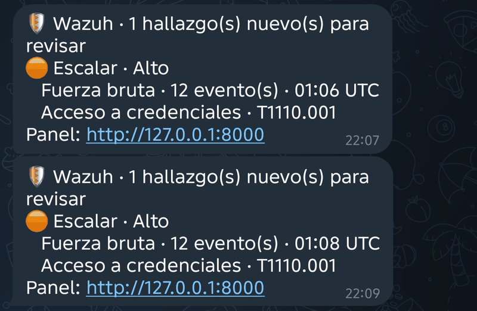

# Modo Wazuh en vivo

Volver al [README](../README.md).

Opcional y **apagado por defecto**. Conecta Wazuh con el analizador: cada alerta que Wazuh genera llega a la app, el motor de siempre las analiza y, si lo configuras, te avisa por Telegram. Sin la variable `WAZUH_INGEST=on` el endpoint ni existe, y el resto de la app funciona exactamente igual.

```
Wazuh (alerta nivel ≥ 5) → integración custom-soc-analyzer → POST /api/wazuh/alerts → motor de reglas → aviso mínimo a Telegram
                                                                                          └→ panel web (instantánea para revisar y decidir)
```

## Qué hace y qué no

- **El motor decide la criticidad.** Es el mismo de los archivos: reglas deterministas, MITRE ATT&CK y consultas para el SIEM. **No interviene ninguna IA** en el análisis automático ni en los avisos. Si quieres triaje o informe con IA, lo pides tú desde el panel, como siempre.
- **Qué entiende hoy de Wazuh:** eventos de Windows (Seguridad, System, Sysmon y PowerShell), inicios de sesión SSH y `sudo` en Linux (a partir de `full_log`). Cualquier otra alerta se conserva como contexto con su descripción, su regla y su técnica MITRE, y se cuenta en el estado.
- **Solo recibe alertas, no los eventos crudos.** Wazuh recibe los logs de los agentes, los pasa por sus decodificadores y reglas y genera alertas; al analizador llegan únicamente las que superan el `level` configurado. Lo que ninguna regla de Wazuh marcó (o quedó por debajo del nivel) no llega, así que el análisis es sobre el flujo de alertas y no sobre todo lo que ocurrió en el equipo.
- **Nada se escribe en disco.** Las alertas viven en una ventana en memoria (24 h y 5.000 filas por defecto). Al reiniciar el servicio empieza vacía; las alertas siguen guardadas en Wazuh.
- **Cada hallazgo se avisa una sola vez.** Crítico y Alto salen en el ciclo de análisis (cada 60 s si llegaron alertas nuevas). Medio y Bajo se juntan en un **resumen cada hora**, marcados como «posibles falsos positivos, revisar».
- **Si un hallazgo ya avisado sube de severidad, se avisa de nuevo.** Pasa con las ráfagas que llegan a medias: con 6 intentos fallidos el hallazgo es Medio (va al resumen) y, cuando llegan los demás, pasa a Alto y sale el aviso inmediato, una sola vez por subida.

## Puesta en marcha

1. En el `.env` del analizador:

   ```ini
   WAZUH_INGEST=on
   WAZUH_INGEST_TOKEN=una-clave-larga-de-16-o-mas-caracteres
   ```

   Con una clave más corta el endpoint queda **cerrado** (no abierto) y se avisa en el registro.

   **Si el analizador corre en Docker** y Wazuh también, súmalo a la red de Wazuh con el archivo incluido (el nombre de la red lo ves con `docker network ls`; con el compose oficial de un solo nodo es `single-node_default`, y si es otro lo defines en el `.env` como `WAZUH_DOCKER_NETWORK`):

   ```bash
   docker compose -f docker-compose.yml -f docker-compose.wazuh.yml up -d --build
   ```

   El manager de Wazuh llega entonces al analizador como `http://soc-analyzer:8000`. El puerto sigue publicado solo en `127.0.0.1` de tu equipo.

2. En el manager de Wazuh, copia `integrations/wazuh/custom-soc-analyzer` y `custom-soc-analyzer.py` a `/var/ossec/integrations/` y dales los permisos que Wazuh exige. Si el manager corre en Docker, hazlo dentro del contenedor:

   ```bash
   chown root:wazuh /var/ossec/integrations/custom-soc-analyzer*
   chmod 750 /var/ossec/integrations/custom-soc-analyzer*
   ```

   Si los permisos no son estos, Wazuh ignora la integración **sin mostrar un error**.

3. En `/var/ossec/etc/ossec.conf` del manager:

   ```xml
   <integration>
     <name>custom-soc-analyzer</name>
     <hook_url>http://soc-analyzer:8000/api/wazuh/alerts</hook_url>
     <api_key>la-misma-clave-de-WAZUH_INGEST_TOKEN</api_key>
     <level>5</level>
     <alert_format>json</alert_format>
   </integration>
   ```

   Reinicia el manager (`/var/ossec/bin/wazuh-control restart`, o `docker restart <contenedor>` si corre en Docker).

   **Por qué `level` 5 y no más alto.** El analizador detecta patrones (fuerza bruta, escalamiento, movimiento lateral…) **correlacionando varios eventos**, así que necesita ver los eventos sueltos y no solo el resumen que genera Wazuh. Cada fallo de inicio de sesión de Windows o de SSH es una alerta de nivel 5; con un `level` de 7 o más solo llegaría la alerta agregada (nivel 10), que es una única fila, y el motor no encontraría nada que correlacionar. Con 5 no llegan los **inicios de sesión exitosos**, que Wazuh marca con nivel 3. Sin ellos el motor detecta la fuerza bruta, pero no puede ver que después la cuenta entró. Si el acceso exitoso viene de una **IP pública**, el motor lo marca como hallazgo Crítico de acceso externo; con una IP de la red interna (por ejemplo en un laboratorio) no lo considera externo y no genera ese hallazgo, pero el evento queda igual como evidencia en la línea de tiempo. Si quieres esa visibilidad completa, usa `<level>3</level>` (comprobado con Wazuh real: con 3 llegan los inicios de sesión exitosos de SSH): hay más alertas (más trabajo para Wazuh, que lanza el script una vez por alerta, y más filas en la ventana), pero los avisos de Telegram siguen siendo por hallazgo, no por alerta. Si llegan demasiadas, súbelo de a poco o filtra por grupo de reglas con `<group>`.

   **Si el manager corre en Docker** (compose oficial de un solo nodo), edita el `ossec.conf` de **dentro del contenedor** (`docker exec -it <contenedor> vi /var/ossec/etc/ossec.conf`, o con `sed`). `/var/ossec/etc` es un volumen y el archivo de tu carpeta `config/wazuh_cluster/` no se vuelve a copiar al reiniciar, así que un cambio hecho solo ahí no se aplica. Para comprobar que Wazuh lo tomó, mira que el registro diga `Enabling integration for: 'custom-soc-analyzer'` (`grep -i integrator /var/ossec/logs/ossec.log | tail`); si dice `Remote integrations not configured`, la integración no está cargada.

   **Al recrear el contenedor del analizador, usa siempre los dos archivos de compose:** `docker compose -f docker-compose.yml -f docker-compose.wazuh.yml up -d --force-recreate`. Con el comando simple (`docker compose up -d`) el contenedor sale de la red de Wazuh: la integración, que lo busca por el nombre `soc-analyzer`, deja de encontrarlo y **las alertas dejan de llegar sin ningún error visible** (en los registros del analizador solo se ven los chequeos de salud). Se comprueba con `docker inspect soc-incident-analyzer-analyzer-1 --format "{{json .NetworkSettings.Networks}}"`, que debe incluir `single-node_default`.

4. Abre la app. Si el modo está activo y ya llegaron alertas, en el inicio aparece **Abrir alertas de Wazuh (N)**. Abre una **instantánea** del último análisis: una sesión normal, con triaje, consultas para el SIEM e informes. Las alertas que lleguen después aparecen al volver a abrirla, y las decisiones que tomes viven en esa foto.

## Probar la integración

Con un agente de Windows conectado y su canal de Seguridad activo (lo es por defecto), desde **cmd** en ese equipo:

```
for /L %i in (1,1,12) do @net use \\127.0.0.1\ipc$ Mala%i /user:usuariofalso
```

Son 12 inicios de sesión fallidos con un usuario que no existe (no bloquea ninguna cuenta). En uno o dos minutos el estado (`GET /api/wazuh/status`) muestra las alertas recibidas y, si configuraste Telegram, llega el aviso **Escalar · Alto**. En el panel, **Abrir alertas de Wazuh** muestra el hallazgo de fuerza bruta con el origen de la ráfaga.

Dos cosas que conviene saber al leer el panel:

- **Las horas están en UTC**, como en el resto de la app: en Argentina son 3 horas menos.
- Si Wazuh etiquetó los eventos con severidad baja, el motor suma la observación **«El SIEM clasificó como Informational o Low…»**: avisa de que la clasificación del SIEM se quedó corta frente a lo que el motor detectó. No es una amenaza más, es una brecha de calidad, y por eso no genera aviso en Telegram.

## Telegram (opcional)

1. Crea un bot con `@BotFather` y guarda el token. Escríbele un mensaje y obtén tu `chat_id` (por ejemplo con `https://api.telegram.org/bot<TOKEN>/getUpdates`).
2. En el `.env`:

   ```ini
   TELEGRAM_BOT_TOKEN=...
   TELEGRAM_CHAT_ID=...
   APP_BASE_URL=http://127.0.0.1:8000     # solo para el enlace del aviso
   ```

Un aviso tiene este aspecto:

```
🛡️ Wazuh · 2 hallazgo(s) nuevo(s) para revisar
🔴 Escalar · Crítico
   Credenciales · 3 evento(s) · 12:02 UTC
   Acceso a credenciales · T1003
🟠 Escalar · Alto
   Fuerza bruta · 12 evento(s) · 12:00 UTC
   Acceso a credenciales · T1110
Panel: http://127.0.0.1:8000
```



Cada hallazgo muestra su severidad y la recomendación del motor, el **tipo** (genérico: «Fuerza bruta», «Credenciales»…), cuántos eventos lo sustentan, la hora del primero (UTC), la táctica y la técnica MITRE.

> **Privacidad.** Telegram es un servicio en la nube y los mensajes de un bot no van cifrados de extremo a extremo. Por eso, por defecto, el aviso **no** lleva usuarios, IPs, comandos, rutas ni logs, ni siquiera el nombre del equipo; ese solo se agrega con `TELEGRAM_INCLUDE_HOST=1`. El detalle se ve en el panel, que corre en tu red. El token del bot nunca se escribe en los registros.
>
> Si aceptas que esos datos pasen por Telegram (un laboratorio, por ejemplo), `TELEGRAM_DETAIL=full` suma el título del hallazgo, el equipo, las cuentas y las IPs. Sigue sin incluir comandos, rutas ni logs. Es una decisión explícita: está apagada por defecto.

## Contexto desde el Indexer (opcional)

Con esto, cada hallazgo muestra el botón **Ver contexto en Wazuh (Indexer)**: consulta tu Indexer y lista lo que pasó en ese equipo o con esa IP
unos minutos antes y después, para ver el entorno del hallazgo y no solo la alerta. Es de **solo lectura** y apagado por defecto.

1. En el Dashboard de Wazuh crea un usuario interno con rol de solo lectura sobre `wazuh-alerts-*` (y `wazuh-archives-*` si lo usas). No uses `admin`.
2. En el `.env` del analizador:
   ```
   WAZUH_INDEXER_URL=https://single-node-wazuh.indexer-1:9200
   WAZUH_INDEXER_USER=usuario-de-solo-lectura
   WAZUH_INDEXER_PASSWORD=...        # solo en el .env
   WAZUH_INDEXER_VERIFY=0            # certificado autofirmado de laboratorio
   ```
3. Recrea el contenedor con los dos compose (debe estar en la red de Wazuh para resolver ese nombre).

La consulta la arma el servidor (no el navegador), con ventana de `WAZUH_INDEXER_WINDOW_MIN` minutos (5) y hasta `WAZUH_INDEXER_MAX` registros (100). La contraseña nunca se muestra ni se registra;
los errores (clave rechazada, sin conexión) aparecen como mensajes genéricos.

**Eventos crudos:** el Indexer guarda por defecto solo alertas. Los eventos sin alerta (`wazuh-archives-*`) existen únicamente si activas `<logall_json>yes</logall_json>` en el manager
y el archivado en Filebeat; es opcional, consume bastante disco y puedes no mirarlo con `WAZUH_INDEXER_ARCHIVES=off`. Sin ese índice, el contexto muestra solo alertas.

## Seguridad del endpoint

- Clave propia en el encabezado `X-Wazuh-Token` (comparación en tiempo constante). Aparte de `APP_ACCESS_TOKEN`: una no reemplaza a la otra.
- Los intentos con clave incorrecta se bloquean (429) tras 10 en un minuto; el endpoint admite hasta 600 alertas por minuto por origen.
- Máximo 1 MB y 200 alertas por llamada. Los campos se recortan y se limpian de caracteres de control; la interfaz los escapa al mostrarlos.
- **No lo expongas a Internet.** Déjalo dentro de la red del laboratorio o de Docker, donde Wazuh llega al analizador y nadie más.
- El script reenvía solo a `http://` o `https://` y no sigue redirecciones (la clave viaja en un encabezado). Si el analizador no responde, Wazuh sigue funcionando: la alerta ya quedó en su propio índice.

## Variables

| Variable | Por defecto | Qué hace |
|---|---|---|
| `WAZUH_INGEST` | apagado | `on` activa el modo |
| `WAZUH_INGEST_TOKEN` | — | Clave de la integración (16+ caracteres) |
| `WAZUH_ANALYZE_SECONDS` | 60 | Cada cuánto se analiza si hay alertas nuevas (10 a 3600) |
| `WAZUH_WINDOW_HOURS` | 24 | Cuánto se conservan en memoria (1 a 168) |
| `WAZUH_MAX_ROWS` | 5000 | Máximo de alertas en la ventana (100 a 20000) |
| `WAZUH_DIGEST_MINUTES` | 60 | Resumen de lo medio y bajo (1 a 1440) |
| `TELEGRAM_BOT_TOKEN`, `TELEGRAM_CHAT_ID` | — | Activan los avisos |
| `WAZUH_INDEXER_URL`, `_USER`, `_PASSWORD` | — | Activan el contexto desde el Indexer |
| `WAZUH_INDEXER_VERIFY`, `_CA` | verificar | Certificado autofirmado o CA propia |
| `WAZUH_INDEXER_WINDOW_MIN`, `_MAX`, `_ARCHIVES` | 5, 100, on | Ventana, tope de registros y uso de `wazuh-archives` (`off` para no consultarlo) |
| `APP_BASE_URL` | — | Enlace al panel en el aviso (solo `http://` o `https://`) |
| `TELEGRAM_INCLUDE_HOST` | no | `1` agrega el nombre del equipo al aviso |
| `TELEGRAM_DETAIL` | básico | `full` suma título, equipo, cuentas e IPs al aviso (ver Privacidad) |

## Probarlo sin Wazuh

```bash
curl -s -X POST http://127.0.0.1:8000/api/wazuh/alerts \
  -H "X-Wazuh-Token: $WAZUH_INGEST_TOKEN" -H "Content-Type: application/json" \
  -d '{"id":"t1","timestamp":"2026-11-12T12:00:00.000+0000","rule":{"id":"60122","level":5,"description":"Logon failure"},"agent":{"name":"WS-01"},"data":{"win":{"system":{"eventID":"4625","channel":"Security","severityValue":"AUDIT_FAILURE"},"eventdata":{"targetUserName":"admin","ipAddress":"203.0.113.50","logonType":"3"}}}}'
```

El estado se consulta en `GET /api/wazuh/status` (cuántas alertas hay, cuántas se entendieron, si Telegram está configurado).

## Límites

- Es un análisis **por ventana**: la fuerza bruta o el movimiento lateral se detectan con las alertas que están en la ventana, así que si Wazuh solo envía las de nivel alto, el motor verá menos contexto que con los eventos crudos. Baja el `level` si quieres más.
- Una alerta de Wazuh ya es una detección. El motor la vuelve a evaluar con sus reglas; coincidirán a menudo, pero no siempre.
- El nivel de Wazuh se traduce a la «severidad del SIEM» (nivel 3 o menos = Informational). Por eso la observación «El SIEM clasificó como Informational o Low…» puede aparecer cuando una alerta de nivel bajo forma parte de un incidente.
- Las decisiones del analista viven en la instantánea y no sobreviven a reabrirla ni a reiniciar el servicio, igual que las sesiones normales.
- Las alertas de integridad de archivos no se interpretan más allá de su descripción. Las de **vulnerabilidades** se traducen (CVE, paquete y estado) y, con el contexto activado, se cruzan con CISA KEV y EPSS ([CONTEXTO.md](CONTEXTO.md)). Ojo: en la imagen Docker oficial de Wazuh 4.14 el módulo de vulnerabilidades viene **desactivado** (`<vulnerability-detection><enabled>no`) y, en las pruebas con esa versión, no generó alertas: el cruce se comprobó enviando una alerta de vulnerabilidad con el formato de Wazuh al analizador.
